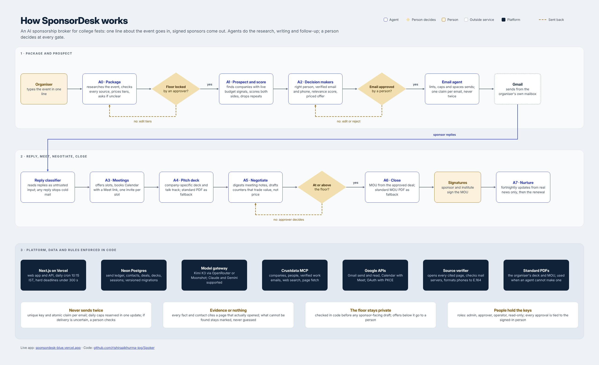

# SponsorDesk

Sponsorship brokerage agents for any event (college fests, conferences, hackathons, meetups, sports and cultural events): find sponsors with live budget signals, write priced offers, follow up without ever double-sending, classify replies, negotiate inside the floor, draft the MOU. Humans only for meetings, negotiation and exceptions. Every decision cites its reasons.

**Two paid services.** [Crustdata](https://crustdata.com) (`CRUSTDATA_API_KEY`) supplies company, people and web data. [Sarvam AI](https://www.sarvam.ai) (`SARVAM_API_KEY`, optional) adds voice and Indian languages. The decisions stay with explicit rules and templates: same input, same output, every score shown factor by factor, and a sponsor email can never instruct the desk.

### How Sarvam is used
| Feature | Sarvam model | What it does |
|---|---|---|
| Ask the desk by voice | Saaras v4 (speech to text) | Turns a spoken question into text in the language it was spoken |
| Ask and answer in Indian languages | Text language ID, Mayura | Detects the language and how it is written (Hinglish, Marathi-English, Tamil in Tamil script…), translates the question for the rules, then answers back the same way: code-mixed in English letters for Hinglish-style messages, the native script otherwise. Company and event names are never translated |
| Off-topic and advice questions | Sarvam 105B (`sarvam-105b-conversations`, override with `SARVAM_CHAT_MODEL`) | Answers what the rules do not cover, briefly and with a little humour off-topic, then steers back |
| Voice commands | Saaras v4, Sarvam 105B | Rules handle common commands; the model picks from a fixed menu for the rest. A company name misheard by one letter is matched to the closest company on your desk |
| Listen to a reply | Bulbul v3 (text to speech) | Reads an assistant answer aloud; a spoken question is answered aloud |
| Read sponsor replies | Mayura | Translates replies written in Indian scripts into English; the same reply rules then classify them |
| Dictate meeting notes | Saaras v4 (speech to English) | Records in 25 second pieces and writes the notes in English |
| Tidy notes | Sarvam 105B | Cleans dictated notes for the A5 digest; a person reads them first |
| Discovery strategist | Sarvam 105B | Picks and orders the final sponsor list from real candidates, with one reason each shown on the company card |

Sarvam never scores companies, sets prices or writes sponsor emails. If it fails or the key is missing, the desk carries on with its rules in English, and the voice buttons are hidden. Calls run on the server through `src/lib/sarvam.ts`, so the key never reaches the browser.

### What one company costs in Crustdata credits
| Step | Endpoint | Credits |
|---|---|---|
| Discover ~10 companies | `/company/search` | about 6 to 10 |
| Score one company | `/company/enrich` (no `people` group: it is megabytes) | 2 |
| Find decision makers | `/person/search` (12 results) | about 3 |
| Business emails for the top 2 | `/person/enrich` with `contact.business_emails` | 4 |
| Event brief web check | `/web/search/live` | 1 |

Roughly 10 credits per fully researched sponsor. Credits are only charged when a call returns data.

## Try the demo

A clickable demo runs on GitHub Pages with fictional sample data: see the link in this repository's About panel. It runs entirely in your browser (`demo/`), so there is no real login, nothing is sent, and your changes stay in your own browser. The real app needs a server and a database; `Run it on your laptop` below shows how.

## What you see

- **Guided event brief.** Type the event the way you would describe it to a sponsor. A live meter scores the brief and shows what is missing (organiser, dates, footfall, audience, goal, postal address) and why each matters, with one-click examples. Then pick the sponsor categories you want (14, mapped to Crustdata industries) and any brands you already have in mind, or skip and let the desk choose.
- **Companies.** A priority list where every card says who the company is, why it fits your event, both scores, the offer and the decision maker. Open one for the full story, people, next steps and timeline.
- **Agents.** The eight agents as two assembly lines (win the deal, close and keep) with live status, real numbers and where they need you.
- **Ask the desk.** A chat assistant on every screen that explains what is going on, why a company was picked, who to contact, what is waiting for you and how to do anything. It reads the desk's own data, so English answers need no AI key. Pick an answer language (English plus 11 Indian languages) from the header; it is remembered. With `GEMINI_API_KEY` or `SARVAM_API_KEY` it also answers questions the rules do not cover (sponsorship advice, follow-ups, and off-topic chat with a touch of humour before steering back), remembers the last few messages, and suggests follow-up questions. Desk numbers still come only from the desk's own data.
- **Voice control (Sarvam).** Press **Alt+V** or the mic and talk, in English or any Indian language. Navigate ("open the outbox", "show Zepto", "show fintech companies"), act ("approve the Zepto email", "approve all drafts", "send the approved emails", "score this", "find people at Zepto", "build a deck for it", "prepare the offer", "add Decathlon", "check replies", "find 10 sponsors", "lock the floor at 3 lakh", "sign out"), ask ("why is Snitch a P1?", "read this page"), and control the screen ("answer in Hindi", "dark mode", "go back"). "This" or "it" means the company whose panel is open. Saaras transcribes, Mayura translates, simple rules handle common commands instantly and Sarvam 105B handles the rest, choosing only from a fixed menu of pages, companies and actions. Anything that spends credits or locks prices waits for "yes" or a click. With a text field focused, what you say is typed into it in English (dictation, Wispr Flow style). The mic shows only when `SARVAM_API_KEY` is set.
- **Past sponsors.** Add your event website and Instagram handle in the brief. The desk reads your sponsors and partners pages directly (logo names included); if a site builds its pages with JavaScript, it reads them again through Crustdata's rendered fetch. It also picks sponsor shout-outs from Instagram posts that search engines indexed and runs a sponsor-focused web search. Past sponsors go to the top of the company list as returning sponsors.
- **Event-size-aware discovery.** Before searching, the desk sizes the event (footfall, days, tier prices, Instagram reach), then searches five pools: early-stage companies with fresh funding, fast growers, established brands, companies headquartered in your city or its metro area, and brands in this season's news for sponsoring events like yours. Small events lean on early-stage and local companies, because big brands rarely say yes to them. With `SARVAM_API_KEY`, a strategist pass (Sarvam 105B) then reviews twice as many candidates as needed and picks and orders the final list for your event, with one reason each; it can only choose from real candidates, and scores, prices and emails stay with the rules. Each company shows why it was picked.
- **Sarvam (optional).** With `SARVAM_API_KEY` set: ask the desk by voice or in Hindi and other Indian languages and hear the answer, read sponsor replies written in Indian scripts, and dictate meeting notes in any Indian language. Without the key nothing changes. Assistant facts, sponsor replies and dictated notes are sent to Sarvam to do this.
- Design: the neutral shadcn Base UI admin template (Next.js 16, Tailwind 4, Geist), light and dark, sized in rem so it scales on phones and PCs.

## Run it on your laptop (no database account)

Node 22.5 or newer:

```bash
npm install
SQLITE_PATH=./desk.db APP_PASSWORD=choose-a-password CRUSTDATA_API_KEY=your-key npx next dev
```

Open http://localhost:3000 and sign in with any email and that password (the first sign-in creates the admin), or add `GOOGLE_CLIENT_ID`/`GOOGLE_CLIENT_SECRET` and use "Continue with Google" instead.

## How it is built



## Links

| | |
|---|---|
| Live app | https://spoker-agent.vercel.app/ |
| Sample sponsor deck (Cult.fit x Aavhan) | https://sponsordesk-blue.vercel.app/d/5fa28c2a505a45ff8957 |
| Demo walkthrough (Loom) | https://www.loom.com/share/4ec4186105f14dc88216a162973b5b2a |
| Sample MOU drafted by A6 (Zepto x E-Summit 2027, unsigned draft) | [docs/sample-mou-zepto-esummit-draft.pdf](docs/sample-mou-zepto-esummit-draft.pdf) |
| Architecture diagram (image) | [docs/sponsordesk-architecture.png](docs/sponsordesk-architecture.png) |
| Second walkthrough (Loom) | https://www.loom.com/share/22be30b955e94dc7b3f8815d8f7cefee |
| Standard deck and MOU used when the agent cannot produce one | [public/fallback](public/fallback) |

## What it does

| Stage | Agent | In this app |
|---|---|---|
| Package | A0 | One line in (name, organiser, dates, city, footfall, goal). One Crustdata web search for published numbers and past sponsors. Tiers priced by a stated rule (about INR 40 per attendee for title, scaled by event type), floor at 80% of the smallest tier, all editable |
| Prospect | A1 | Crustdata company search: companies in your country with a funding round in the last 12 months or 8%+ headcount growth, in industries that fit your event type; brand-unsafe categories skipped |
| Score | A1 | Dual point of view: our view x the company marketing team's view; priority = the lower of the two; every score shows its signals |
| Decision makers | A2 | Crustdata people search for brand, partnership, campus or CSR owners at that company (not the CEO at 200+ people); alumni of the organiser flagged as warm paths; business email only if it belongs to THIS company (Crustdata often returns an address from a previous employer, which is rejected); checked (syntax, domain, MX) and scored out of 100 with the breakdown |
| Pitch | A2 | First email is a priced offer (activation, price range, metric, reply "send"), never a meeting request |
| Follow up | A2 | Max 3 emails, one thread per company, auto follow-ups only while nobody replied |
| Replies | A2 | Gmail sweep, rule-based classifier (interested, meeting, questions, referral, not now, declined, opt-out, out of office with return date, bounce), amounts in lakh or INR, prompt-injection attempts flagged; cold mail stops for the whole company |
| Meet and negotiate | A3 to A5 | Scheduling emails, a 10-slide company deck with talk track, meeting notes turned into goals, next steps and a recap; below-floor offers become exceptions with a three-option trade counter (never a discount) for a human to approve |
| Close and nurture | A6, A7 | 11-section MOU draft from the deal sheet; fortnightly sponsor updates from the team's own news |

## Safety rules enforced in code (`lib/ledger.ts`)

- Every email passes the linter (no em/en dashes, no placeholders, signature, postal address, opt-out on cold mail) before it can be queued.
- Only a signed-in user with the approver or admin role can approve; the approver is taken from the session, never from the request. The agent can only auto-approve follow-ups to companies that never replied.
- A unique key per email plus an atomic claim. If Gmail may have sent a message but we could not confirm it (timeout, 5xx, database error after sending), it becomes `send_unknown`, is checked against Gmail Sent, and goes to a person after 6 hours. It is never resent automatically. Exactly-once delivery through an external mail provider cannot be guaranteed; this design prefers a possibly-missed email that a human resolves over a duplicate.
- Daily caps and spacing are reserved with one conditional UPDATE, so concurrent workers cannot exceed them; suppression list for opt-outs and bounces; erasure redacts the person from contacts, emails, replies, meeting notes, decks, logs, exceptions and MOUs (DPDP).
- Out-of-office pauses a sequence instead of killing it; a reply on a live deal never resets its stage.
- Cold emails are held until the organisers' written permission is recorded in Settings.

## Accounts and security

Sign in with Google (`GOOGLE_CLIENT_ID`/`GOOGLE_CLIENT_SECRET`, same app as Gmail below, with `/api/auth/google/callback` added as a second authorised redirect URI). Anyone with a Google account can sign in; there is no team password to share or leak.

**Private desks.** Every person who signs up gets their own desk: their own event, companies, contacts, emails, settings and Gmail connection. Each desk lives in its own Postgres schema (`ws_<id>`), or its own SQLite file locally, so a query can only ever see the signed-in person's data. Signing in again later continues exactly where they stopped, back on the page they last had open. An admin can invite teammates into their desk from Settings > Team (by email; they sign in with Google).

**Owner activity.** The first person ever to sign in is the owner and keeps the original desk. The owner's **Activity** page lists every person, their desk and progress, every sign-in (time, Google or password, device, IP) and every action (wrote a brief, ran discovery, approved an email). The owner can open any desk **read-only**; changes are refused until they exit. Passwords and email bodies are never written to the activity log. A legacy `APP_PASSWORD` email/password form still works underneath "Use a password instead", for a desk that has not set up Google yet. Sessions are random tokens stored hashed, expire after 7 days, and can be revoked. Logins are rate limited. Every write must come from the app's own origin. The Gmail connection (for sending) is separate from sign-in and uses its own one-time state bound to the session plus PKCE; its refresh token is stored encrypted (`TOKEN_KEY`, else `APP_PASSWORD`). `GET /api/cycle` only runs for Vercel Cron with `CRON_SECRET`.

## Tests

Node 22.5 or newer (`.nvmrc`). `npm run test:all` runs the ledger, email-engine failure, security and decision-maker, and end-to-end agent tests (A0 to A7 plus the reply classifier), plus workspace isolation (private desks, the owner's read-only view, the audit trail), with Crustdata, Gmail and DNS mocked from the live API's response shapes (the test fails if any AI provider is called) and `node:sqlite` standing in for Postgres. These prove the logic; row locking itself is Postgres behaviour and is not exercised by SQLite. CI runs typecheck, tests and build on every push and pull request.

## Deploy on Vercel

1. Import this repo in Vercel.
2. Storage > Create Database > Neon (free). This adds `DATABASE_URL`.
3. Environment variables: `GOOGLE_CLIENT_ID`, `GOOGLE_CLIENT_SECRET` (sign-in, and Gmail below), `CRUSTDATA_API_KEY`, `CRON_SECRET`, optional `SARVAM_API_KEY`, `GEMINI_API_KEY`, `TOKEN_KEY` and `SD_COUNTRY` (default `IND`). `APP_PASSWORD` is only needed as a fallback if Google is not set up yet.
4. Redeploy. Open the app and press **Continue with Google**: the first sign-in becomes admin. Raise teammates' roles in Settings > Team as they sign in, then type the event in one line.

### Google sign-in and Gmail (one app, two redirect URIs)
Google Cloud Console > APIs & Services: enable the Gmail API, OAuth consent screen (External, Testing, add your testers), Credentials > OAuth client ID > Web application, with **two** authorised redirect URIs: `https://<your-app>.vercel.app/api/auth/google/callback` (sign-in, everyone) and `https://<your-app>.vercel.app/api/google/callback` (Gmail, admin only). Put the client id and secret in Vercel, redeploy. Sign-in works immediately; Gmail still needs Settings > Connect Google (admin) to send instead of draft mode.

### Instagram (optional: read your own posts for past sponsors)
Uses Meta's official Instagram API with Instagram Login (scope `instagram_business_basic`, read-only). developers.facebook.com > Create app > add the **Instagram** product > "API setup with Instagram business login". Add the redirect URI `https://<your-app>.vercel.app/api/instagram/callback`, copy the Instagram app ID and secret into `INSTAGRAM_APP_ID` and `INSTAGRAM_APP_SECRET`, and redeploy. The event's account must be a Professional (Business or Creator) account. Until Meta's app review approves the app, only Instagram accounts added as testers under App roles can connect. Then on the Event brief, under Past sponsors, press **Connect Instagram**: the desk reads up to two years of the account's own captions for sponsor shout-outs and @mentions, each linked to its post. The token is stored encrypted in that desk only and refreshed before it expires; Disconnect removes it.

The daily cycle runs on weekdays at 10:15 IST (Vercel cron) and from the "Run daily cycle" button.

## Skill pack

`skills/` holds the full SponsorDesk skill pack (orchestrator, email agent, A0 to A7, council reviewer, demo mode) for use directly in Claude, plus vendored MIT skills from samber/dev-event-organizer-skills and coreyhaines31/marketingskills.

## Honest limits

- Instagram shows little to logged-out visitors, and the desk never works around its login wall or bot checks: it reads the follower count and only the posts search engines indexed, so it misses many. Connecting the event's own account (see Instagram setup above) reads its posts properly, with the organiser's consent. Sponsor logo walls that a site loads with JavaScript after the page opens stay unreadable, because a rendered page's text has no images. In both cases, type the past sponsors you know.
- A discovery run costs a few more Crustdata credits than before: up to 3 size pools, 1 local search, 1 news search and 1 name lookup (about 6 to 8 calls instead of 1 to 2).
- Sponsor replies are translated only when written in an Indian script: Hindi typed in English letters stays untranslated. Dictation is live only, not an uploaded recording.
- Contacts and signals are only as good as Crustdata's coverage; the app never invents an email, and unverified emails raise an exception for a person to check.
- Templates are plain and consistent rather than creative. Every draft waits for a human, so edit freely before approving.
- Prices are a rule of thumb. Check them against what peer events charge before you lock the floor.
- Meeting digests use keyword extraction: paste clean notes (Google Meet's notes work well) and read the recap before approving it.
- The MOU is a draft for the institute's office, not legal advice. GST and TDS treatment must be confirmed by the accounts office.
